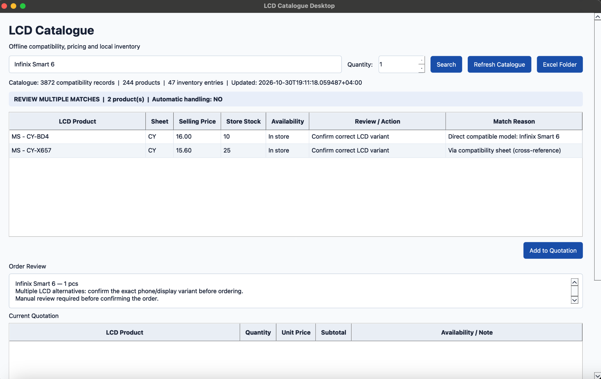
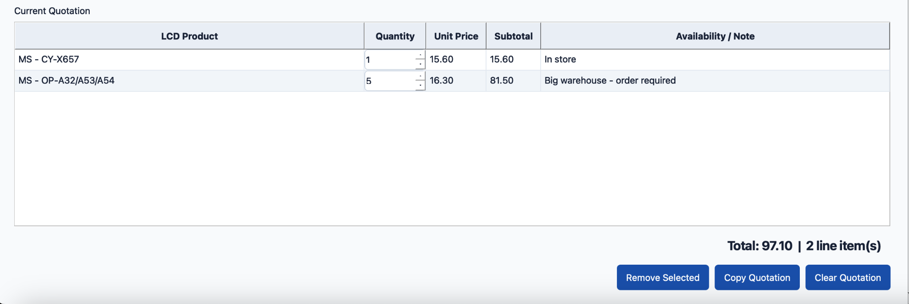

# LCD Catalogue Desktop

**Offline inventory lookup and quotation automation for a UAE mobile-device trading business**

A Python desktop application that turns three operational Excel workbooks into one searchable LCD product catalogue. Staff can identify compatible displays, review selling prices and local stock, and build multi-item quotations without manually cross-referencing spreadsheets.

Developed for a real business workflow at **FALAK LINK MOBILE TRADING LLC**. The application was tested with its intended users, and their feedback informed the search, quotation, and interface improvements.

> **Portfolio note:** The company's original workbooks and generated catalogue contain business information and are intentionally excluded from this repository. This project does not use AI/ML or a SQL database; its matching and validation rules are implemented in Python.

## Application screenshots

The screenshots below show the application used with company-approved examples. They illustrate the staff-facing UI; the repository does not include the corresponding proprietary Excel workbooks.

**Search and compatibility review**



**Multi-item quotation and live total**



## Business problem

Product information was distributed across three different Excel workbooks:

1. **Compatibility list** — phone names and manufacturer model codes.
2. **LCD price list** — products, compatibility descriptions, and selling prices.
3. **Available models** — local store stock and pricing.

Preparing a quotation required looking up compatible models, checking the correct selling price, and confirming local availability. This was a repetitive and error-prone manual process.

## Solution

- **Cross-sheet product lookup:** Search by model code or phone name, with normalization, compatibility cross-references, and partial-name browsing.
- **Traceable matches:** Display why a product matched; broad searches and alternative products require manual review.
- **Inventory decisions:** Show store quantity or identify products listed in the price catalogue but not in local inventory as warehouse-order items.
- **Pricing safeguards:** Use the selling price from the main price catalogue; never substitute purchasing cost when a selling price is missing.
- **Multi-item quotations:** Add selected products, change quantities, calculate live totals, remove items, and copy a customer-facing list.
- **Local Excel synchronization:** Detect saved workbook changes, rebuild the local JSON catalogue, and retain the prior valid catalogue when conversion fails.
- **Offline operation:** No cloud service or internet connection is required for ordinary lookup and quotation use.

## Technology

| Component | Technology |
| --- | --- |
| Application and business logic | Python |
| Desktop UI | PySide6 (Qt) |
| Excel ingestion | openpyxl |
| Local catalogue | JSON |
| Windows packaging | PyInstaller |
| Source control | Git / GitHub |

## Data flow

```text
Compatibility workbook ──┐
Price workbook ──────────┼──> Excel validation + normalization
Inventory workbook ──────┘                 |
                                          v
                               Local catalogue (JSON)
                                          |
                                          v
                              Search + matching rules
                                          |
                                          v
                           Stock review + quotation UI
```

Excel inputs remain the source of truth; the generated JSON is a local read-optimized snapshot, not a separate transactional inventory database.

## Code structure

- `app.py` — desktop interface, search results, quotation actions, and automatic refresh.
- `lookup_engine.py` — deterministic model matching, price/stock lookup, and review flags.
- `excel_sync.py` — Excel extraction, validation, and atomic JSON refresh.
- `requirements.txt` — Python dependencies.
- `build_windows.bat` — Windows build script.
- [`USER_GUIDE.md`](USER_GUIDE.md) — instructions written for business employees.

## Try the demonstration

A small, **fully fictional** dataset is included at [`examples/demo_catalogue.json`](examples/demo_catalogue.json). Its phone names, prices, and stock counts are invented for demonstration and do not represent the client's actual business data.

1. Install dependencies as described below.
2. Create the `data/` directory locally.
3. Copy `examples/demo_catalogue.json` to `data/lcd_catalogue.json`.
4. Run `python app.py`.

Sample searches:

| Search | Expected behavior |
| --- | --- |
| `DemoPhone A1` | One product with 12 units in local stock; selling price 24.50 |
| `DemoPhone B2` | One product listed for warehouse ordering; selling price 31.25 |
| `DemoPhone C3` | Selling price missing, so quoting is blocked pending review |

Try adding **DemoPhone A1** and **DemoPhone B2** to the quotation, changing their quantities, and copying the resulting list.

The fictional catalogue demonstrates the search and quotation functions. It does **not** test Excel synchronization with original-format workbooks; that workflow requires three appropriately structured workbooks.

## Running locally

Requires Python 3.10+. The fictional demo works without the business workbooks; Excel synchronization of real data requires three appropriately structured workbooks.

```bash
python -m venv .venv
```

Activate the environment:

- Windows: `.venv\Scripts\activate`
- macOS/Linux: `source .venv/bin/activate`

Install and run:

```bash
pip install -r requirements.txt
python app.py
```

The application can load an existing `data/lcd_catalogue.json` or create/update it from workbooks in `data/excel/`. The **Excel Folder** control can point to another local folder holding the three source files. The expected worksheet names and columns are specified in `excel_sync.py`.

### Build for Windows

Run `build_windows.bat` on a Windows machine with Python installed. The packaged application is produced under `dist/LCDCatalogueDesktop/`.

**Important:** The provided build script expects `data/lcd_catalogue.json` to exist locally and copies it into the build. Do not publish or distribute a build containing actual company data without authorization.

## Design decisions and limitations

- Model matching is rule-based. Similar names do **not** guarantee physical screen compatibility; staff must verify ambiguous results.
- A product appearing in the main price list but not in local stock is treated according to the client's warehouse-order workflow; local warehouse quantities are not tracked.
- Quotation generation does not reserve stock, deduct inventory, or place purchases.
- Quotation contents are session-only and are not persisted after the app closes.
- The application is intended for local use, not simultaneous multi-user inventory editing.
- Proprietary Excel workbooks, pricing, and live inventory snapshots are not included in the repository.

## Outcome

The project was delivered as a working Windows application and refined based on user feedback, including broader catalogue search, match explanations, and a combined quotation builder. Quantified time savings and sales impact are **not claimed here** until independently measured.

**Developer:** Yonatan Moges

For day-to-day employee instructions, see the [Staff User Guide](USER_GUIDE.md).
